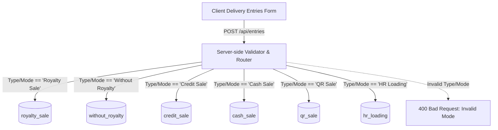

# Daily Entry App (MaterialMApp) — Reverse Engineering, Architecture & Implementation Plan

**Project Name:** MaterialMApp (Daily Entry & Material Delivery Management System)  
**File:** `PROJECT.md`  
**Date:** October 14, 2026  
**Status:** Approved Architecture & Implementation Plan  

---

## 1. Executive Summary & Objective

The objective of this project is to convert the existing Google Sheets + AppSheet **MaterialMApp** Daily Delivery Entry application into a high-performance, secure, responsive, full-stack coded web application. 

The application will operate seamlessly on:
1. **Desktop / Chrome Browser**: Desktop dashboard, responsive data tables, modal dialogs, search, and filtering.
2. **Mobile Browser / PWA (App Mode)**: Touch-optimized steppers, adaptive mobile forms, responsive navigation, fast on-site data entry.

### Core Architectural Pillars
- **Strict Reverse Engineering**: Exact replication of business logic, calculations, dropdowns, conditional visibility, and master-child linkages from the inspected AppSheet application.
- **Direct Destination Saving (Zero-Staging Rule)**: Transactions route directly into their respective MongoDB destination collections (`royalty_sale`, `without_royalty`, `credit_sale`, `cash_sale`, `qr_sale`, `hr_loading`) without any staging or duplicate intermediate copies.
- **Master Data Management**: A dedicated Master Input & Management interface matching the master sheet structure (Screenshot 1), enforcing strict uniqueness on all columns (VehicleNo, TransportName/Type, MaterialName, PartyName, Type/Mode) with real-time dropdown reflection.
- **Secure Authentication**: Email/password authentication with JWT sessions, role handling, secure login/logout, and protected endpoints.

---

## 2. Reverse Engineering Inventory (Source Analysis)

Analysis based on the 5 visual artifacts provided:
- **Screenshot 1**: Master Google Sheet (`VehicleNo`, `TransportName`, `MaterialName`, `PartyName`, `Type/Mode`).
- **Screenshot 2**: AppSheet Main UI ("MaterialMApp") showing "All Entries" data grid, sidebar navigation, top app bar, and "+ Add" button.
- **Screenshots 3, 4, 5**: "Delivery Entries Form" modal showing field order, data types, stepper controls (`-` / `+`), and calculated fields.

### 2.1 Master Data Inventory (Screenshot 1)

| Field / Column | Type | Sample Values from Master Sheet | Uniqueness Rule | Purpose |
|---|---|---|---|---|
| **ID** | Auto-increment / Int | 1, 2, 3, 4, 5, 6, 7 | Primary Key | Master row tracking |
| **VehicleNo** | String (Alpha-numeric) | `MP09GG1230`, `MP09BS6668`, `MP09GG7934`, `MP09GG1150`, `RJ09GE1458` | Unique (Case-insensitive) | Vehicle registration dropdown |
| **TransportName** (TransportType) | String | `MSK`, `VMPL` | Unique | Transporter dropdown |
| **MaterialName** | String | `10MM`, `20MM`, `GSB`, `M-SAND` | Unique | Quarry / mining material |
| **PartyName** | String | `NAWAZ KHAN`, `ALTAMASH KHAN`, `SAGEER PATEL`, `PUSHPENDRA`, `ANIL AARIYA` | Unique | Customer / contractor party |
| **Type/Mode** | String (Enum) | `Royalty Sale`, `HR Loading`, `Without Royalty`, `Credit Sale`, `Cash Sale`, `QR Sale` | Fixed Allowlist (6 modes) | Transaction classification & destination router |

*Note: In the master sheet, columns are independent distinct lists. Any new entry added to a master category must be unique and immediately available in the transaction entry form dropdowns.*

---

### 2.2 Delivery Entry Form Field Inventory (Screenshots 2-5)

| Field Name | Control Type | Required | Initial / Default Value | Visibility / Show_If | Editable_If | Notes / Formula |
|---|---|---|---|---|---|---|
| `Date` | Date Picker | **Yes** | Current Date (e.g. `10/14/2026`) | Always | Yes | Standard transaction date |
| `ChallanNo` | Text Input | **Yes** | Auto-sequence `CH-0001`, `CH-0002`... | Always | Read-only / Locked | Auto-incremented unique challan number |
| `VehicleNo` | Dropdown Select | **Yes** | None | Always | Yes | Sourced from Master Vehicles |
| `TransportType` | Dropdown Select | **Yes** | None | Always | Yes | Sourced from Master Transports |
| `Type/Mode` | Dropdown Select | **Yes** | None | Always | Yes | 6 core modes (Royalty Sale, Without Royalty, Credit Sale, Cash Sale, QR Sale, HR Loading) |
| `HR Loading Type` | Radio / Dropdown | Conditional | None | `[Type/Mode] = "HR Loading"` | Yes | Allowed: `"With Royalty"`, `"Without Royalty"` |
| `MaterialName` | Dropdown Select | **Yes** | None | Always | Yes | Sourced from Master Materials |
| `PartyName` | Dropdown Select | **Yes** | None | Always | Yes | Sourced from Master Parties |
| `CUM` | Stepper (`-` / `+`) | No | `0` | Always | Yes | Cubic Meters measurement |
| `ETP No.` | Text / Number Input | No | Empty | Always | Yes | Electronic Transit Pass / Government Permit |
| `G.WT` | Stepper (`-` / `+`) | No | `0` | Always | Yes | Gross Weight (e.g. 60,790, 12,000) |
| `T.WT` | Stepper (`-` / `+`) | No | `0` | Always | Yes | Tare Weight (Truck empty weight) |
| `NET WT` | Numeric Display | Auto | `0` | Always | Read-Only | **App Formula:** `[G.WT] - [T.WT]` |
| `Rate` | Stepper (`-` / `+`) | **Yes** | `0` | Always | Yes | Rate per Ton / CUM |
| `Amount` | Numeric Display | Auto | `0` | Always | Read-Only | **Formula:** `NET WT > 0 ? (NET WT * Rate) : (CUM * Rate)` |
| `Payment Mode` | Radio / Dropdown | Conditional | Cash (if Cash Sale), QR (if QR Sale) | `IN([Type/Mode], LIST("Cash Sale", "QR Sale"))` | Yes | Cash or QR |
| `GST Rate` | Dropdown / Stepper | Conditional | `5%` / `18%` / `0` | GST Condition (see below) | Yes | Applicable tax percentage |
| `GST Amount` | Numeric Display | Auto | `0` | GST Condition (see below) | Read-Only | **App Formula:** `[Amount] * [GST Rate] / 100` |
| `Total Amount` | Numeric Display | Auto | `0` | Always (or GST Cond) | Read-Only | **App Formula:** `[Amount] + [GST Amount]` |

---

## 3. Formula, Conditional Visibility & Business Logic Engine

### 3.1 Conditional Visibility Rules

1. **HR Loading Type Visibility:**
   ```
   Show_If: [Type/Mode] == "HR Loading"
   Options: ["With Royalty", "Without Royalty"]
   ```

2. **GST Fields Visibility (`GST Rate`, `GST Amount`, `Total Amount`):**
   ```
   Show_If:
     ([Type/Mode] == "Royalty Sale") 
     OR 
     ([Type/Mode] == "HR Loading" AND [HR Loading Type] == "With Royalty")
   ```
   *Behavior on Hide:* When the condition evaluates to `false`, reset `GST Rate = 0`, `GST Amount = 0`, and set `Total Amount = Amount`. Hidden fields must never submit stale values to the database.

3. **Payment Mode Visibility & Defaults:**
   ```
   Show_If: [Type/Mode] IN ("Cash Sale", "QR Sale")
   Default Value Rule:
     - If [Type/Mode] == "Cash Sale" -> "Cash"
     - If [Type/Mode] == "QR Sale"   -> "QR"
     - If user selects another Type/Mode -> cleared/null
   ```

### 3.2 Calculation Rules (Client Reactive + Server Validated)

1. **Net Weight Calculation:**
   $$\text{NET WT} = \max(0, \text{G.WT} - \text{T.WT})$$

2. **Base Amount Calculation:**
   $$\text{Amount} = \begin{cases} 
   \text{NET WT} \times \text{Rate} & \text{if } \text{NET WT} > 0 \\ 
   \text{CUM} \times \text{Rate} & \text{otherwise} 
   \end{cases}$$

3. **GST Amount Calculation:**
   $$\text{GST Amount} = \frac{\text{Amount} \times \text{GST Rate}}{100}$$

4. **Total Amount Calculation:**
   $$\text{Total Amount} = \text{Amount} + \text{GST Amount}$$

---

## 4. Direct Destination Routing Architecture (Zero-Staging MongoDB)

As required by **Section 3: Direct Destination Saving — Critical Requirement**:
- No staging table (`Delivery Entry`) will hold records before copying.
- No background copy jobs or duplicate documents.
- Strict server-side allowlist maps `Type/Mode` directly to target collections:



### Destination Routing Mapping Table

| Form `Type/Mode` | Destination MongoDB Collection | Specific Required Fields |
|---|---|---|
| `Royalty Sale` | `royalty_sale` | `GST Rate`, `GST Amount`, `Total Amount`, `ETP No.` |
| `Without Royalty` | `without_royalty` | Standard entry fields (GST omitted/zero) |
| `Credit Sale` | `credit_sale` | `PartyName` mandatory, standard entry fields |
| `Cash Sale` | `cash_sale` | `Payment Mode = "Cash"` |
| `QR Sale` | `qr_sale` | `Payment Mode = "QR"` |
| `HR Loading` | `hr_loading` | `HR Loading Type` ("With Royalty" / "Without Royalty"), conditional GST |

### Unified "All Entries" Query Layer
For the "All Entries" view (Screenshot 2), the API provides a unified read endpoint (`GET /api/entries`) that aggregates across all 6 collections using MongoDB aggregation `$unionWith` or a multi-collection parallel query, preserving real-time consistency with zero duplication.

---

## 5. Master Data Input & Management Architecture

As per the user's specific requirement:
> *"JO SCREEN SHOT DIYA FIRST O MASTER KA INPUT FORM HOGA ISME SE HAR COLUMN NIQUES HAI AUR ADD AKR SAKTE AHIA AUR HAR ENRTY UNIQUE HOGI OHK SIMPLE APP BNANA HAI"*

### Master Data Collections / Structure
Master items can be stored in categorized collections or a unified `MasterItem` schema:
```typescript
interface IMasterItem {
  _id: ObjectId;
  category: "VehicleNo" | "TransportName" | "MaterialName" | "PartyName";
  value: string; // e.g. "MP09GG1230", "MSK", "10MM", "NAWAZ KHAN"
  code?: string;
  isActive: boolean;
  createdAt: Date;
  updatedAt: Date;
}
```

### Master Uniqueness Constraints:
- Unique compound index on `{ category: 1, value: 1 }` with collation `{ locale: 'en', strength: 2 }` (case-insensitive deduplication).
- Trimming leading/trailing whitespace before insertion.
- Master Management UI allows:
  1. Tabbed view or multi-column grid matching Screenshot 1.
  2. Direct "+ Add New" for Vehicle, Transport, Material, or Party.
  3. Inline validation warning if an item already exists.
  4. Instant availability in the Daily Entry form dropdowns without app reload.

---

## 6. Authentication & User Management (Login & Logout)

### User Model
```typescript
interface IUser {
  _id: ObjectId;
  email: string;
  passwordHash: string;
  name: string;
  role: "admin" | "operator" | "viewer";
  createdAt: Date;
}
```

### Features:
- **JWT-based Session Management**: Secure HTTP-only cookies or Bearer Authorization token.
- **Login Screen**: Clean, elegant login interface with MaterialMApp branding.
- **Header User Menu**: Displays active user initial/avatar (matching the "F" in Screenshot 2), user email, and "Logout" action.
- **Route Guards**: Frontend route protection; redirects unauthenticated visitors to `/login`.
- **API Middleware**: Validates JWT on all protected endpoints (`/api/entries/*`, `/api/masters/*`).

---

## 7. User Interface & Layout Design

Replicating the look, feel, and colors of **MaterialMApp**:

### 7.1 Color Palette & Styling Tokens
- **Primary Brand Color**: `#107569` / `#008080` (Teal branding from Screenshot 2 logo)
- **Top App Bar**: `#134e4a` / `#0f766e` (Deep teal blue, clean contrast with white text)
- **Sidebar**: Light neutral slate (`#f8fafc`), active item highlighted with soft blue-teal (`#e0f2fe`) and primary icon
- **Card & Background**: Clean white (`#ffffff`) on off-white body (`#f1f5f9`)
- **Action Buttons**: Primary solid `#0284c7` (Sky-700 / `#0d6efd`), Ghost/Cancel `#64748b`
- **Form Controls**: Modern input border `#cbd5e1`, focus ring `#0284c7`
- **Stepper Controls**: Clean `[-]` and `[+]` border buttons framing the numeric value

### 7.2 Chrome / Desktop View
- Left Sidebar with:
  - Dashboard
  - All Entries (Active Grid)
  - Masters Management (New dedicated view for Screenshot 1)
  - About
- Top Navbar with:
  - Hamburger toggle
  - Logo: "MaterialMApp" (Teal hexagon icon)
  - Global search bar: "Search All Entries"
  - Sync / Refresh button
  - User avatar with dropdown (Profile, Logout)
- Main Content Area:
  - Header: "All Entries" + "+ Add" button
  - Responsive Data Table with columns matching Screenshot 2: Date, ChallanNo, VehicleNo, TransportType, Type/Mode, PartyName, MaterialName, CUM, ETP No., G.WT, T.WT, NET WT, Rate, Amount, Total Amount.

### 7.3 Mobile / App-Responsive View
- Mobile drawer navigation triggered by hamburger menu.
- Touch-friendly stepper controls with generous tap targets (44px min).
- Full-screen or bottom-sheet modal for "Delivery Entries Form".
- Mobile card list view or horizontally scrolling table for entries.

---

## 8. Technology Stack & Directory Structure

- **Backend**: Node.js + Express + MongoDB (Mongoose) + JWT Auth
- **Frontend**: Single Page Application with Vanilla JS/CSS or React/Vite, designed with visual fidelity to AppSheet MaterialMApp.
- **Security**: Helmet, CORS, input sanitization, bcrypt password hashing.

### Proposed Directory Layout
```
ManageAPP/
├── PROJECT.md                      # This comprehensive blueprint
├── package.json                    # Project configuration & scripts
├── .env.example                    # Environment variable template
├── server/                         # Backend Application
│   ├── config/                     # DB connection & constants
│   ├── controllers/                # Auth, Masters, Entries controllers
│   ├── middleware/                 # Auth verification, error handling
│   ├── models/                     # Schemas: User, MasterItem, 6 Destination Models
│   ├── routes/                     # API Routes (/api/auth, /api/masters, /api/entries)
│   ├── services/                   # Auto-sequence generator (ChallanNo), calculations
│   └── index.js                    # Server entry point
├── client/                         # Frontend Application
│   ├── index.html                  # Main HTML entry point
│   ├── css/                        # Custom modular styling (Design system, table, form)
│   │   ├── style.css
│   │   ├── components.css
│   │   └── responsive.css
│   ├── js/                         # Application logic
│   │   ├── api.js                  # Fetch wrapper with Auth header
│   │   ├── auth.js                 # Login / Logout session management
│   │   ├── masters.js              # Master CRUD & uniqueness enforcement
│   │   ├── form.js                 # Reactive Delivery Entries form & stepper logic
│   │   ├── table.js                # Data grid, sorting, filtering & search
│   │   └── app.js                  # Main application orchestrator & router
│   └── assets/                     # Icons, logos, svg assets
└── tests/                          # Automated verification tests
    ├── destinationRouting.test.js  # Direct 6-collection routing tests
    ├── calculations.test.js        # Net wt, Amount, GST, Total formulas
    └── conditionalVisibility.test.js # AppSheet Show_If expressions
```

---

## 9. Verification & Gap Analysis

| Item | Verified from Artifacts | Assumption / Resolution |
|---|---|---|
| **6 Type/Mode Values** | Verified (Master Sheet Col F & prompt) | Exact match: Royalty Sale, Without Royalty, Credit Sale, Cash Sale, QR Sale, HR Loading |
| **6 Destination Collections** | Verified from Prompt Specification | Exact collection names: `royalty_sale`, `without_royalty`, `credit_sale`, `cash_sale`, `qr_sale`, `hr_loading` |
| **Challan Numbering** | Verified (`CH-0001` through `CH-0007`) | Auto-increment format `CH-%04d` |
| **Weight Calculations** | Verified (`NET WT = G.WT - T.WT`) | Stepper input with reactive Net Weight calculation |
| **GST Logic** | Verified (`Amount * Rate / 100`, Show_If formula) | Conditionally shown for Royalty Sale & HR Loading (With Royalty) |
| **Payment Mode** | Verified (Cash for Cash Sale, QR for QR Sale) | Automatic default assignment, hidden for others |
| **Master Columns Uniqueness** | Specified by User | Each column list in Screenshot 1 is treated as unique set of items |

---

## 10. Implementation Plan & Milestones

1. **Phase 1: Project Plan Approval (Current Step)**
   - Create `PROJECT.md` documenting all reverse-engineered rules, schemas, and workflows.
2. **Phase 2: Database Models & Backend Core**
   - Setup MongoDB connection.
   - Implement MasterItem model with case-insensitive unique indexes.
   - Implement 6 Destination Models (`RoyaltySale`, `WithoutRoyalty`, `CreditSale`, `CashSale`, `QrSale`, `HrLoading`).
   - Implement Challan Counter & auto-generation logic.
   - Setup Authentication (User model, JWT login/logout, seed initial user).
3. **Phase 3: Backend API Endpoints**
   - Auth endpoints (`/api/auth/login`, `/api/auth/me`, `/api/auth/logout`).
   - Master endpoints (`/api/masters`, `/api/masters/:category`, add unique items).
   - Entry endpoints (`POST /api/entries` with direct destination routing, `GET /api/entries` unified view).
4. **Phase 4: Frontend Development (MaterialMApp UI)**
   - Build responsive layout with Sidebar, Topbar, and Navigation.
   - Build Login & Logout workflow.
   - Build "Masters Management" view (replicating Screenshot 1 with unique addition).
   - Build "Delivery Entries Form" modal with reactive calculations and conditional fields (Screenshots 3-5).
   - Build "All Entries" data table with search & filter (Screenshot 2).
5. **Phase 5: Automated Testing & Verification**
   - Run verification tests on routing, calculation formulas, and conditional logic.
6. **Phase 6: User Review & Deployment Guide**
   - Provide complete startup and usage instructions.
